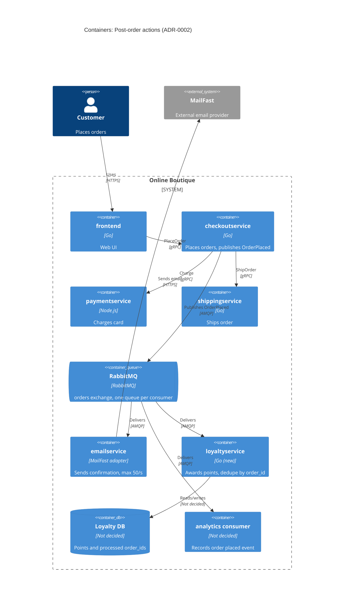

# ADR-0002: Publish an "OrderPlaced" event to RabbitMQ for post-order actions

- **Status:** Proposed
- **Date:** 2026-10-28
- **Deciders:** ชัชชัย ปานปรีดา

## Context and problem

R-12 (`docs/scenario.md`) กำหนดให้หลังสั่งซื้อสำเร็จ ระบบต้อง 
(1) ส่งอีเมลยืนยันผ่าน **MailFast** แทน logic mock ของ `emailservice` 
(2) ให้ loyalty points ผ่าน `loyaltyservice` ใหม่ 
(3) บันทึก analytics event "order placed" และ marketing คาดว่าปีหน้าจะมี post-order action เพิ่ม (SMS, fraud scoring, recommendations update)

**สภาพปัจจุบัน (จากโค้ด):**

| ข้อเท็จจริง | หลักฐาน |
|---|---|
| `PlaceOrder` เรียก downstream ทั้งหมดแบบ synchronous gRPC ตามลำดับ ใช้ `ctx` เดียวกันตลอดและไม่ได้ตั้ง timeout ต่อ call: (1) `cartservice.GetCart` (2) `productcatalogservice.GetProduct` + `currencyservice.Convert` ทีละ item (3) `shippingservice.GetQuote` (4) `currencyservice.Convert` ค่าส่ง (5) `paymentservice.Charge` (6) `shippingservice.ShipOrder` (7) `cartservice.EmptyCart` (8) `emailservice.SendOrderConfirmation` | `system/online-boutique/src/checkoutservice/main.go`: `PlaceOrder` (บรรทัด 238, 252, 258, 263, 273); `prepareOrderItemsAndShippingQuoteFromCart` (บรรทัด 290, 294, 298, 302); `prepOrderItems` (บรรทัด 344, 348) |
| ถ้าส่งอีเมลล้มเหลว จะแค่ log warning และ order ยังสำเร็จ; ผลของ `EmptyCart` ก็ถูกทิ้ง (`_ =`) | `main.go` บรรทัด 273–277 (`log.Warnf("failed to send order confirmation ...")`), บรรทัด 263 |
| ถ้า payment หรือ shipping ล้มเหลว `PlaceOrder` คืน error (order ล้ม) | `main.go` บรรทัด 253–255, 259–261 |
| `checkoutservice` ผูกกับ downstream แต่ละตัวผ่าน env var + gRPC connection (`EMAIL_SERVICE_ADDR`, `mustConnGRPC`) | `main.go` บรรทัด 81–82, 115, 122 |
| Order ID เป็น UUID ที่สร้างใน `PlaceOrder` | `main.go` บรรทัด 233 (`uuid.NewUUID()`) |
| `checkoutservice` ไม่มี data store ของตัวเอง | ไม่พบ DB client ใน `main.go` (struct `checkoutService` บรรทัด 66–86 มีแต่ gRPC connection) |

**ตัวเลขที่สำคัญ (`docs/scenario.md`):**

- p95 ของ `PlaceOrder` ต้อง **≤ 500 ms** (ปัจจุบัน ≈ 300 ms) ⇒ เหลือ budget ≈ 200 ms
- MailFast p95 **1.5 s**, p99 **8 s**, ล้มเหลว ≈ **0.5 %**, rate limit **50 emails/s**
- Peak **200 orders/s** (11.11) ⇒ อีเมลเกิน rate limit **4 เท่า** ⇒ backlog โต ≈ **150 emails/s** (≈ 9,000 ฉบับต่อนาที, ≈ 540,000 ฉบับต่อชั่วโมงของ peak)
- Loyalty points: ภายใน **1 นาที** และ **exactly once**
- Order ต้อง **ไม่ล้มเหลว** เพราะ email / loyalty / analytics ล่ม

**ปัญหา:** ถ้าเรียก MailFast แบบ synchronous ใน `PlaceOrder` จะทำลาย latency budget ทันที (p95 1.5 s > 500 ms) และชน rate limit ช่วง peak ส่วนการเพิ่ม gRPC call ใหม่ทุกครั้งที่มี action ใหม่ ทำให้ `checkoutservice` ต้องแก้และ deploy ใหม่ทุกครั้ง เราต้องตัดสินใจว่า `checkoutservice` จะสั่งงาน post-order action อย่างไร

## Decision drivers

1. **Availability:** order ต้องไม่ล้มเหลวเพราะ email / loyalty / analytics ล่ม
2. **Performance:** p95 `PlaceOrder` ≤ 500 ms ที่ 200 orders/s
3. **Correctness ของ loyalty:** business ต้องการให้ points ถูกให้ **ครั้งเดียวต่อ order** ภายใน 1 นาที แต่ message broker ทั่วไป (รวม RabbitMQ) รับประกันได้แค่ **at-least-once delivery** (ข้อความอาจมาซ้ำ) ดังนั้น "exactly once" ต้องได้จาก **idempotent consumer** (dedupe ด้วย `order_id`) ไม่ใช่จาก broker; และต้องลดโอกาสที่ event จะไม่ถูกส่งเลย (at-most-once ฝั่ง publish)
4. **Modifiability:** เพิ่ม SMS, fraud scoring, recommendations ปีหน้าโดยไม่ต้องแก้ `checkoutservice`
5. **Rate limit ของ MailFast:** 50 emails/s ต้องรับ peak 200 orders/s ได้โดยไม่ทิ้งอีเมล
6. **Operability / team fit:** self-hosted, open-source, รันบน Kubernetes; ทีม 4 คน เก่ง Go/gRPC, 2 คนเคยใช้ RabbitMQ

## Considered options

1. **Synchronous gRPC ต่อขยาย:** `PlaceOrder` เรียก `emailservice` (MailFast), `loyaltyservice`, analytics ตามลำดับเหมือนเดิม
2. **Fire-and-forget ใน process:** `PlaceOrder` ตอบลูกค้าก่อน แล้วยิง gRPC call แต่ละตัวใน goroutine
3. **Event-driven ผ่าน RabbitMQ (self-hosted):** `checkoutservice` publish event `OrderPlaced` หนึ่งครั้งไปที่ exchange; `emailservice`, `loyaltyservice`, analytics consumer แต่ละตัวมี queue ของตัวเอง
4. **Event-driven ผ่าน Apache Kafka (self-hosted)**

### Pros and cons of the options

| Option | Pros | Cons |
|---|---|---|
| 1. Sync gRPC | ง่าย; ทีมคุ้นเคย; ไม่มี component ใหม่ | MailFast p95 1.5 s / p99 8 s ทำ p95 เกิน 500 ms; ชน rate limit 50/s ตอน peak; `checkoutservice` ต้องแก้ทุก action ใหม่ (coupling สูง) |
| 2. Goroutine fire-and-forget | latency ของลูกค้าไม่เพิ่ม; ไม่มี component ใหม่ | งานหายถ้า pod restart (ไม่มี durability); ไม่มี retry/backpressure ต่อ rate limit; loyalty ครั้งเดียวต่อ order ทำไม่ได้; ยังต้องแก้ `checkoutservice` ทุก action ใหม่ |
| 3. RabbitMQ | publish ครั้งเดียว (≈ ms) ใน `PlaceOrder`; queue เป็น buffer ให้ email ส่งได้ตาม 50/s; retry + dead-letter queue; เพิ่ม consumer ใหม่โดยไม่แตะ `checkoutservice`; open-source, self-hosted บน Kubernetes; มีคนในทีมเคยใช้ 2 คน | component stateful ใหม่ต้อง operate; delivery เป็น at-least-once ⇒ consumer ต้อง idempotent; ถ้า broker ล่มตอน publish ต้องมีแผนรองรับ |
| 4. Kafka | throughput สูงมาก; replay event ย้อนหลังได้ (มีประโยชน์กับ analytics) | หนักเกินไปสำหรับ 200 events/s; operate ยากกว่า; ไม่มีข้อมูลว่าทีมเคยใช้ (Not evidenced in the provided files); rate limiting / retry ต่อข้อความต้องเขียนเอง; delivery ไปยัง consumer ภายนอก (MailFast, loyalty DB) ก็ยังเป็น at-least-once เหมือนกัน |

## Decision

เลือก **Option 3: publish `OrderPlaced` event ไปที่ RabbitMQ (self-hosted บน Kubernetes)**

- `checkoutservice` ทำ payment + shipping แบบเดิม (synchronous) แล้ว publish `OrderPlaced` **หนึ่งครั้ง** (มี `order_id` จาก `uuid.NewUUID()`, email, items, total) แทนการเรียก `sendOrderConfirmation` (`main.go` บรรทัด 273)
- ใช้ fanout/topic exchange `orders`; แต่ละ consumer มี queue แยก ⇒ email ที่ช้าไม่ทำให้ loyalty ช้า
  - `emailservice` → MailFast, จำกัด consumer rate ≤ 50 emails/s, retry with backoff, dead-letter queue
  - `loyaltyservice` → **idempotent ด้วย `order_id`** (unique key) ⇒ at-least-once delivery + dedupe = ผลลัพธ์แบบ exactly once (points ครั้งเดียวต่อ order)
  - analytics consumer → ส่ง event ให้ marketing
- เหตุผล: เป็น option เดียวที่ตอบ driver 1–5 พร้อมกัน และเข้ากับ driver 6 (open-source, self-hosted, ทีมมีประสบการณ์ RabbitMQ) ส่วน Kafka ให้ความสามารถเกินความต้องการที่ 200 events/s

### ถ้า publish ไป RabbitMQ ไม่สำเร็จ `checkoutservice` ทำอะไร

ค่าตัวเลขในส่วนนี้ (timeout, ขนาด buffer, ระยะ retry) เป็น **ค่าที่ ADR นี้เสนอ** ไม่ได้มาจาก scenario และต้องยืนยันด้วย load test

1. Publish แบบ persistent message + **publisher confirms** ตั้ง timeout **100 ms** (อยู่ใน budget ≈ 200 ms ที่เหลือ)
2. ถ้าได้ confirm ⇒ ตอบลูกค้าตามปกติ
3. ถ้า timeout / nack / connection หลุด ⇒ **order ยังสำเร็จเสมอ** (ตาม driver 1 และสอดคล้องกับพฤติกรรมเดิมที่ email ล้มแล้วแค่ log, `main.go` บรรทัด 273–277) แล้ว:
   - ใส่ event ลง **bounded in-memory retry buffer** ใน pod (เสนอ 12,000 events ≈ 60 s ของ peak 200 orders/s)
   - background goroutine retry ด้วย exponential backoff (เริ่ม 100 ms, สูงสุด 5 s) จนกว่าจะ publish สำเร็จ
   - ถ้า buffer เต็ม หรือ pod กำลังจะปิด (SIGTERM) แล้วยัง publish ไม่ได้ ⇒ เขียน **structured error log พร้อม payload เต็มของ event** (`event_lost`, `order_id`) เพื่อให้ replay ได้ด้วยมือ และเพิ่ม metric `orderplaced_publish_lost_total`
4. ผล: event **ไม่หายในกรณีปกติ** ที่ broker สะดุดสั้น ๆ (< ≈ 60 s ที่ peak); จะเสี่ยงหายเฉพาะเมื่อ broker ล่มนานกว่า buffer **และ** pod ตายพร้อมกัน

### จะใช้ transactional outbox หรือไม่: **ไม่ใช้ในตอนนี้**

- `checkoutservice` **ไม่มี DB ของตัวเอง** (struct `checkoutService` บรรทัด 66–86 มีแต่ gRPC connection) ⇒ outbox ต้องเพิ่ม data store stateful ใหม่ให้ checkout ซึ่งเป็น service บน critical path ของรายได้
- การเขียน outbox row เป็นอีก write หนึ่งที่อยู่บน latency path ของ `PlaceOrder` และเป็นจุดที่ทำให้ order ล้มได้ใหม่ (ถ้า DB นั้นล่ม) ⇒ ขัดกับ driver 1 และ 2
- ความเสี่ยงที่เหลืออยู่แคบ (ต้องมี broker ล่มนาน + pod ตายพร้อมกัน) และลดได้ด้วย RabbitMQ HA (ดู Risks)
- ผลกระทบถ้าเกิด: อีเมล/analytics หาย ไม่มีผลทางการเงิน; loyalty หาย ⇒ แก้ได้ด้วย replay จาก log
- **เงื่อนไขทบทวน:** ถ้า `orderplaced_publish_lost_total` > 0 ในเดือนใดก็ตาม หรือ fraud scoring ปีหน้าต้องการ event ครบ 100 % ⇒ ทบทวน ADR นี้และพิจารณา outbox

หมายเหตุ: technology ของ `paymentservice` (Node.js) และ `frontend` (Go) ไม่ได้อยู่ใน context files นี้ **[Inferred]**; protocol ระหว่าง `emailservice` กับ MailFast (HTTPS) ก็ **[Inferred]**; diagram ละ `cartservice`, `productcatalogservice`, `currencyservice` ไว้เพราะไม่เปลี่ยนจาก ADR นี้

## Consequences

- **Positive:** `PlaceOrder` ไม่ต้องรอ MailFast อีกต่อไป เหลือแค่ publish หนึ่งครั้ง (timeout 100 ms) ⇒ p95 น่าจะอยู่ใกล้ 300 ms เดิม (quality attribute: performance) **[Inferred]** ต้องวัดจริง
- **Positive:** email / loyalty / analytics และตัว RabbitMQ เองล่มไม่กระทบ order; queue เก็บงานไว้จน consumer กลับมา (quality attribute: availability)
- **Positive:** queue ดูดซับ peak 200 orders/s แล้วปล่อยอีเมลออกที่ 50/s ตาม rate limit; retry + DLQ รับมือ failure 0.5 % ของ MailFast (quality attribute: reliability)
- **Positive:** action ใหม่ (SMS, fraud scoring, recommendations) = เพิ่ม queue + consumer ใหม่ ไม่ต้องแก้ `checkoutservice` (quality attribute: modifiability)
- **Negative:** มี component stateful ใหม่ต้อง operate, monitor, backup (quality attribute: cost / operability)
- **Negative:** อีเมลจะถึงลูกค้าช้าลงตอน peak เพราะ backlog (quality attribute: performance — email latency)
- **Negative:** at-least-once ⇒ consumer ทุกตัวต้อง idempotent; debugging ข้าม async boundary ยากขึ้น (quality attribute: testability)
- **Negative:** ไม่ใช้ outbox ⇒ ยังมีช่องที่ event หายได้ในกรณีที่ broker ล่มนาน + pod ตาย (quality attribute: reliability / data integrity)
- **Risks and mitigations:**
  - **RabbitMQ HA (broker เป็น single point of failure ของ post-order actions):** cluster 3 nodes เป็น StatefulSet บน Kubernetes, **quorum queues** (replicate 3, รอด 1 node ล่ม), persistent messages + publisher confirms, pod anti-affinity แยก node, `PodDisruptionBudget` `maxUnavailable: 1`; ฝั่ง checkout มี retry buffer ≈ 60 s (ดู Decision) ครอบช่วง failover
  - **MailFast ล้มเหลว / ช้า (0.5 % fail, p99 8 s):** consumer ตั้ง timeout ต่อ call **10 s** (> p99); retry ด้วย exponential backoff ผ่าน delay/retry queue สูงสุด **5 ครั้ง** (เช่น 10 s, 30 s, 1 min, 5 min, 15 min) แล้วส่งเข้า **DLQ** `email.dlq` + alert เมื่อ DLQ > 0; ack หลัง MailFast ตอบสำเร็จเท่านั้น; ใช้ `order_id` เป็น idempotency key ถ้า MailFast รองรับ (Open questions) เพื่อกันอีเมลซ้ำตอน retry. ที่ 50 emails/s และ latency p95 1.5 s / p99 8 s ต้องมี in-flight ≈ 75–400 requests (Little's law: 50 × 1.5 s, 50 × 8 s) ⇒ ตั้ง prefetch/concurrency ให้พอ แต่จำกัด rate ด้วย token bucket 50/s
  - **Backlog ช่วง 11.11 (≈ 150 emails/s):** ที่ 200 orders/s แต่ส่งได้ 50/s ⇒ คิว `email` โต ≈ 150 ข้อความ/s = **9,000 ต่อนาที, 540,000 ต่อชั่วโมง**; ระบายได้หลัง peak ด้วยอัตรา 50/s ลบ order ปกติ (อัตรา order ปกติ Not evidenced in the provided files). Mitigation: (1) คิว email แยกจาก loyalty/analytics ⇒ loyalty ไม่โดน backlog; (2) quorum queue เก็บบน disk, ตั้ง disk/memory alarm ของ RabbitMQ และจัด disk ให้พอสำหรับ backlog ตามระยะเวลา peak (Open questions); (3) **ห้ามตั้ง `x-max-length` ที่ทิ้งข้อความ** ในคิว email; (4) alert ถ้า queue depth หรือ message age เกินค่าที่ตกลงกับ business; (5) ขอ rate limit สูงขึ้นจาก MailFast ก่อน 11.11 ถ้า email SLA ไม่ยอมรับ backlog นี้
  - **Loyalty ได้ซ้ำ:** unique constraint บน `order_id` ใน Loyalty DB, ให้ points และบันทึก `order_id` ใน transaction เดียวกัน, ack หลัง commit
  - **Loyalty เกิน 1 นาที:** queue แยกจาก email, scale consumer ตาม queue depth, alert ถ้า message age ในคิว loyalty > 30 s
  - **Event หายเมื่อ broker ล่มนาน + pod ตาย:** log payload เต็ม + metric `orderplaced_publish_lost_total` เพื่อ replay; ทบทวนเรื่อง outbox ตามเงื่อนไขใน Decision

## Validation

| สิ่งที่ทดสอบ | วิธี | เกณฑ์ผ่าน |
|---|---|---|
| Checkout latency | Load test ด้วย Locust `loadgenerator` (แบบเดียวกับ ADR-0001) ที่ **200 orders/s** ต่อเนื่อง 30 นาที | p95 `PlaceOrder` **≤ 500 ms** |
| Availability | Chaos test ระหว่าง load 200 orders/s: ปิด `emailservice`, `loyaltyservice`, analytics consumer และ RabbitMQ 1 node / ทั้ง cluster ทีละกรณี | order ที่ล้มเพราะ post-order action = **0** |
| Loyalty lag | วัดเวลาจาก order สำเร็จ ถึง points ถูกบันทึก ที่ 200 orders/s | p99 **< 60 s** |
| แต้มซ้ำ | Redeliver event `OrderPlaced` เดิมซ้ำโดยตั้งใจ (เช่น 10,000 event × 2 ครั้ง) และ restart `loyaltyservice` กลางการประมวลผล | order ที่ได้ points มากกว่า 1 ครั้ง = **0** |
| MailFast rate | วัดอัตราเรียก MailFast ระหว่าง peak | ไม่เกิน **50 calls/s** ตลอดการทดสอบ; ไม่มี HTTP 429 จาก MailFast |
| MailFast retry | Inject failure 0.5 % (และทดสอบ 100 % นาน 5 นาที) | อีเมลที่ไม่ได้ส่งและไม่อยู่ใน DLQ = **0**; DLQ = 0 เมื่อ failure 0.5 % |
| Backlog 11.11 | Load 200 orders/s 10 นาที แล้วลดลง | คิว email โต ≈ **150 msg/s** (≈ 90,000 หลัง 10 นาที) ไม่ทิ้งข้อความ และระบายจนหมด |
| Publish failure | ตัด RabbitMQ ทั้ง cluster **30 s** ระหว่าง load 200 orders/s | order ล้ม = **0**; event หาย (`orderplaced_publish_lost_total`) = **0** |
| Review | ทบทวน ADR | ก่อนเพิ่ม consumer ตัวแรกของปีหน้า (SMS / fraud scoring) หรือเมื่อ `orderplaced_publish_lost_total` > 0 |

## Open questions

- **Email SLA:** อีเมลยืนยันต้องถึงลูกค้าภายในกี่นาที? (กำหนดว่า backlog ช่วง peak ยอมรับได้หรือไม่ และค่า alert ของ queue depth)
- **ระยะเวลา peak 11.11 และอัตรา order ปกติ:** peak นานเท่าไร และนอก peak กี่ orders/s? (คำนวณขนาด backlog, disk ของ RabbitMQ และเวลาระบาย)
- **Fraud scoring:** ปีหน้าจะต้อง **block** order ก่อนยืนยันหรือไม่? ถ้าใช่ ต้องเป็น synchronous และไม่เข้ากับ event หลัง order
- **Analytics:** ปลายทางของ event คืออะไร (ระบบไหนของ marketing) และต้องการ schema/latency แบบใด?
- **Loyalty DB และ MailFast API:** ใช้ data store อะไร; MailFast รองรับ idempotency key หรือไม่ (กันอีเมลซ้ำ)?
- **ทีม operate RabbitMQ:** ใครรับผิดชอบ on-call สำหรับ broker (ทีมมี 4 คน)?
