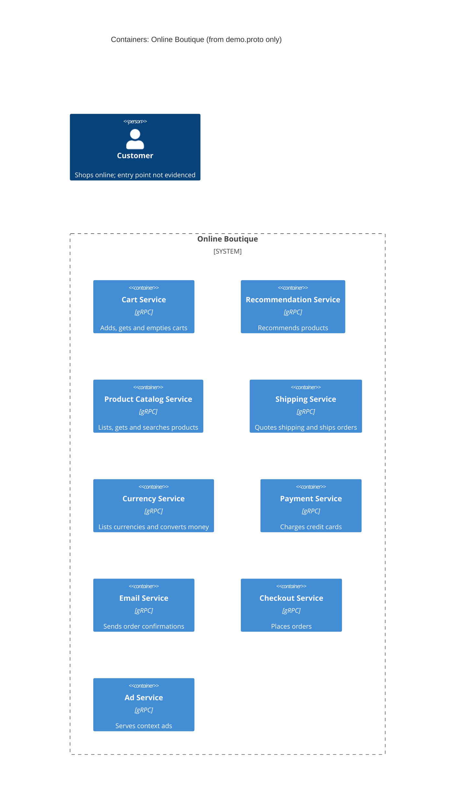

# Task 1, Run A: Recovered architecture (C4 container level)

## 1. Agent

Claude Code (Anthropic), model Claude Opus 5.5 (`claude-opus-5-5`).

## 2. Files read

- `prompts/1-recover-architecture.md` (task instructions)
- `system/online-boutique/protos/demo.proto` (the only evidence)

## 3. Containers table

The proto defines nine gRPC services in package `hipstershop` (`demo.proto` line 17). It does not show how the services are deployed, so treating each `service` as one container is **[Inferred]**.

| Container | Technology / language | Responsibility | Evidence |
|---|---|---|---|
| Cart Service | gRPC (proto3); language not evidenced | Add items, get a user's cart, empty a cart | `system/online-boutique/protos/demo.proto` (`service CartService`: `AddItem`, `GetCart`, `EmptyCart`) |
| Recommendation Service | gRPC (proto3); language not evidenced | Recommend product IDs for a user and a list of products | `system/online-boutique/protos/demo.proto` (`service RecommendationService`: `ListRecommendations`) |
| Product Catalog Service | gRPC (proto3); language not evidenced | List, get and search products (id, name, price, categories) | `system/online-boutique/protos/demo.proto` (`service ProductCatalogService`: `ListProducts`, `GetProduct`, `SearchProducts`) |
| Shipping Service | gRPC (proto3); language not evidenced | Quote shipping cost; ship an order and return a tracking ID | `system/online-boutique/protos/demo.proto` (`service ShippingService`: `GetQuote`, `ShipOrder`) |
| Currency Service | gRPC (proto3); language not evidenced | List supported currencies; convert `Money` between ISO 4217 codes | `system/online-boutique/protos/demo.proto` (`service CurrencyService`: `GetSupportedCurrencies`, `Convert`) |
| Payment Service | gRPC (proto3); language not evidenced | Charge a credit card and return a transaction ID | `system/online-boutique/protos/demo.proto` (`service PaymentService`: `Charge`) |
| Email Service | gRPC (proto3); language not evidenced | Send an order confirmation email | `system/online-boutique/protos/demo.proto` (`service EmailService`: `SendOrderConfirmation`) |
| Checkout Service | gRPC (proto3); language not evidenced | Place an order (user, currency, address, email, card) and return an `OrderResult` | `system/online-boutique/protos/demo.proto` (`service CheckoutService`: `PlaceOrder`) |
| Ad Service | gRPC (proto3); language not evidenced | Return ads for the context keywords of a page | `system/online-boutique/protos/demo.proto` (`service AdService`: `GetAds`) |

Data stores: none. Not evidenced in the provided files.

Note: `option go_package` (line 19) only names the Go package for generated code. It does not show which language any service is written in.

## 4. Dependencies table

| Caller → callee | Protocol | Evidence |
|---|---|---|
| None evidenced | – | A `.proto` file declares the interface each service **offers**. It does not show who **calls** whom. Not evidenced in the provided files. |

## 5. Mermaid diagram

There are no `Rel` lines because no dependency is evidenced (this matches the tables). The Person is included as the task requires, but how the user reaches the system is not evidenced (see Gaps).

## 6. Gaps

| Gap | Why it can't be settled from `demo.proto` | File that would settle it |
|---|---|---|
| Service-to-service calls | The proto declares servers only, not clients | Kubernetes manifests with `*_SERVICE_ADDR` env vars, e.g. `system/online-boutique/kubernetes-manifests/checkoutservice.yaml`, `frontend.yaml`; or each service's source |
| **[Inferred]** Checkout Service calls Cart, Product Catalog, Currency, Shipping, Payment and Email | `PlaceOrderRequest` carries `credit_card`, `email`, `address`, `user_currency`, and `OrderResult` holds `shipping_tracking_id` and `shipping_cost`. This suggests orchestration but doesn't prove it | `system/online-boutique/kubernetes-manifests/checkoutservice.yaml`; checkout service source |
| Web front end / user entry point (UI, HTTP) | No HTTP or UI service appears in the proto | `system/online-boutique/kubernetes-manifests/frontend.yaml`; frontend source |
| Who calls Ad, Recommendation and Product Catalog | Not shown | Kubernetes manifests (env vars); frontend and recommendation service source |
| Data stores (e.g. where carts are kept) | No database or cache is declared | Kubernetes manifests (e.g. `cartservice.yaml`, any Redis manifest); cart service source |
| Implementation language of each service | The proto is language-neutral; `go_package` only covers generated Go code | Each service's source folder / Dockerfile under `system/online-boutique/src/` |
| External systems (real payment gateway, real email provider) | Not shown | Payment and email service source |
| Deployment unit (one container per service?) | Not shown | Kubernetes manifests |
