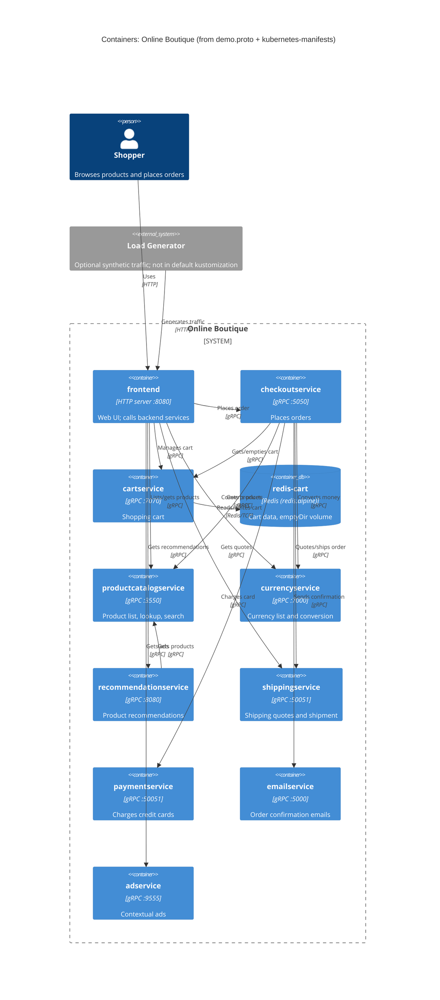

# Task 1 · Run B: Recovered C4 container architecture

Evidence allowed: `system/online-boutique/protos/demo.proto`, `system/online-boutique/kubernetes-manifests/`

## 1. Agent

Claude Code (Anthropic CLI), model **Claude Opus 5.5** (`claude-opus-5-5`).

## 2. Files read

- `prompts/1-recover-architecture.md` (task file)
- `system/online-boutique/protos/demo.proto`
- `system/online-boutique/kubernetes-manifests/README.md`
- `system/online-boutique/kubernetes-manifests/kustomization.yaml`
- `system/online-boutique/kubernetes-manifests/adservice.yaml`
- `system/online-boutique/kubernetes-manifests/cartservice.yaml`
- `system/online-boutique/kubernetes-manifests/checkoutservice.yaml`
- `system/online-boutique/kubernetes-manifests/currencyservice.yaml`
- `system/online-boutique/kubernetes-manifests/emailservice.yaml`
- `system/online-boutique/kubernetes-manifests/frontend.yaml`
- `system/online-boutique/kubernetes-manifests/loadgenerator.yaml`
- `system/online-boutique/kubernetes-manifests/paymentservice.yaml`
- `system/online-boutique/kubernetes-manifests/productcatalogservice.yaml`
- `system/online-boutique/kubernetes-manifests/recommendationservice.yaml`
- `system/online-boutique/kubernetes-manifests/shippingservice.yaml`

## 3. Containers table

Implementation languages are **not evidenced** in the provided files. The manifests give only local image names (e.g. `image: cartservice`), and `README.md` says skaffold fills in the real tags.

| Container | Technology / language | Responsibility | Evidence |
|---|---|---|---|
| `frontend` | HTTP server on port 8080; language not evidenced | Web UI for shoppers, exposed outside the cluster; calls the backend services | `kubernetes-manifests/frontend.yaml` (Service `frontend-external`, `type: LoadBalancer`, port `http`; `httpGet /_healthz`) |
| `cartservice` | gRPC server :7070; language not evidenced | Shopping cart: `AddItem`, `GetCart`, `EmptyCart` | `protos/demo.proto` (`service CartService`); `kubernetes-manifests/cartservice.yaml` (port `grpc` 7070, grpc probes) |
| `redis-cart` | Redis (`redis:alpine`) | Stores cart data; storage is `emptyDir`, so the data is lost when the pod restarts | `kubernetes-manifests/cartservice.yaml` (Deployment `redis-cart`, `image: redis:alpine`, `volumes: redis-data emptyDir`) |
| `productcatalogservice` | gRPC server :3550; language not evidenced | Product list, lookup and search | `protos/demo.proto` (`service ProductCatalogService`); `kubernetes-manifests/productcatalogservice.yaml` |
| `currencyservice` | gRPC server :7000; language not evidenced | Lists supported currencies and converts `Money` | `protos/demo.proto` (`service CurrencyService`); `kubernetes-manifests/currencyservice.yaml` |
| `recommendationservice` | gRPC server :8080; language not evidenced | Recommends product IDs for a user and their products | `protos/demo.proto` (`service RecommendationService`); `kubernetes-manifests/recommendationservice.yaml` |
| `shippingservice` | gRPC server :50051; language not evidenced | Quotes shipping costs and ships orders (returns `tracking_id`) | `protos/demo.proto` (`service ShippingService`); `kubernetes-manifests/shippingservice.yaml` |
| `checkoutservice` | gRPC server :5050; language not evidenced | Places orders (`PlaceOrder`) by coordinating the other services | `protos/demo.proto` (`service CheckoutService`); `kubernetes-manifests/checkoutservice.yaml` (6 `*_SERVICE_ADDR` env vars) |
| `paymentservice` | gRPC server :50051; language not evidenced | Charges a credit card (`Charge` returns `transaction_id`) | `protos/demo.proto` (`service PaymentService`); `kubernetes-manifests/paymentservice.yaml` |
| `emailservice` | gRPC server (Service port 5000 → container port 8080); language not evidenced | Sends order confirmations (`SendOrderConfirmation`) | `protos/demo.proto` (`service EmailService`); `kubernetes-manifests/emailservice.yaml` (`port: 5000`, `targetPort: 8080`) |
| `adservice` | gRPC server :9555; language not evidenced | Returns ads for page context keys (`GetAds`) | `protos/demo.proto` (`service AdService`); `kubernetes-manifests/adservice.yaml` |
| `loadgenerator` *(outside the boundary, optional)* | Traffic generator; init container uses `busybox` and `wget` | Sends synthetic user traffic to the frontend (`USERS=10`, `RATE=1`). Not deployed by default | `kubernetes-manifests/loadgenerator.yaml`; `kubernetes-manifests/kustomization.yaml` (line 24, `# - loadgenerator.yaml` commented out) |

## 4. Dependencies table

How the protocol is evidenced: each callee's Kubernetes Service port is named `grpc` and has a `grpc:` readiness/liveness probe, and its API is a `service` in `demo.proto`. The direction (caller → callee) comes from the caller's `*_ADDR` environment variables.

| Caller → Callee | Protocol | Evidence |
|---|---|---|
| Shopper → `frontend` | HTTP | `frontend.yaml` (Service `frontend-external`, `type: LoadBalancer`, port name `http`, 80→8080) |
| `loadgenerator` → `frontend` | HTTP | `loadgenerator.yaml` (`FRONTEND_ADDR=frontend:80`; init script `wget http://${FRONTEND_ADDR}`) |
| `frontend` → `productcatalogservice` | gRPC | `frontend.yaml` (`PRODUCT_CATALOG_SERVICE_ADDR=productcatalogservice:3550`) |
| `frontend` → `currencyservice` | gRPC | `frontend.yaml` (`CURRENCY_SERVICE_ADDR=currencyservice:7000`) |
| `frontend` → `cartservice` | gRPC | `frontend.yaml` (`CART_SERVICE_ADDR=cartservice:7070`) |
| `frontend` → `recommendationservice` | gRPC | `frontend.yaml` (`RECOMMENDATION_SERVICE_ADDR=recommendationservice:8080`) |
| `frontend` → `shippingservice` | gRPC | `frontend.yaml` (`SHIPPING_SERVICE_ADDR=shippingservice:50051`) |
| `frontend` → `checkoutservice` | gRPC | `frontend.yaml` (`CHECKOUT_SERVICE_ADDR=checkoutservice:5050`) |
| `frontend` → `adservice` | gRPC | `frontend.yaml` (`AD_SERVICE_ADDR=adservice:9555`) |
| `checkoutservice` → `productcatalogservice` | gRPC | `checkoutservice.yaml` (`PRODUCT_CATALOG_SERVICE_ADDR=productcatalogservice:3550`) |
| `checkoutservice` → `shippingservice` | gRPC | `checkoutservice.yaml` (`SHIPPING_SERVICE_ADDR=shippingservice:50051`) |
| `checkoutservice` → `paymentservice` | gRPC | `checkoutservice.yaml` (`PAYMENT_SERVICE_ADDR=paymentservice:50051`) |
| `checkoutservice` → `emailservice` | gRPC | `checkoutservice.yaml` (`EMAIL_SERVICE_ADDR=emailservice:5000`) |
| `checkoutservice` → `currencyservice` | gRPC | `checkoutservice.yaml` (`CURRENCY_SERVICE_ADDR=currencyservice:7000`) |
| `checkoutservice` → `cartservice` | gRPC | `checkoutservice.yaml` (`CART_SERVICE_ADDR=cartservice:7070`) |
| `recommendationservice` → `productcatalogservice` | gRPC | `recommendationservice.yaml` (`PRODUCT_CATALOG_SERVICE_ADDR=productcatalogservice:3550`) |
| `cartservice` → `redis-cart` | Redis protocol (TCP 6379) | `cartservice.yaml` (`REDIS_ADDR=redis-cart:6379`; Service `redis-cart` port name `tcp-redis`) |

No manifest gives `adservice`, `currencyservice`, `emailservice`, `paymentservice`, `productcatalogservice` or `shippingservice` an address env var for another service. In these files they have no outbound dependencies.

## 5. Mermaid diagram

The `Rel` labels say what each call is for. They are **[Inferred]** from the RPC names in `demo.proto`. The manifests show only that a dependency exists, not which RPCs are called.

## 6. Gaps

| Gap | Why it's open | File that would settle it |
|---|---|---|
| Implementation language/framework of each service | Manifests use placeholder image names only | `src/<service>/Dockerfile` or the source files per service; `skaffold.yaml` |
| `shoppingassistantservice` | `frontend.yaml` sets `SHOPPING_ASSISTANT_SERVICE_ADDR=shoppingassistantservice:80`, but no manifest in this folder deploys it, and `ENABLE_ASSISTANT` is commented out. Left out of the diagram | `kustomize/components/shopping-assistant/`; frontend source |
| Packaging service | Only a commented-out `PACKAGING_SERVICE_URL` in `frontend.yaml` | frontend source; any packaging-service docs |
| Which RPCs each caller actually invokes | `demo.proto` defines the APIs but not who calls them | `src/frontend/*.go`/handlers, `src/checkoutservice/` source |
| Whether `emailservice` sends real email, and whether `paymentservice` uses a real payment provider (possible `System_Ext`) | No external endpoints or credentials in manifests | `src/emailservice/`, `src/paymentservice/` source |
| How `productcatalogservice` stores its catalog (file, DB?) | No data store or volume in its manifest | `src/productcatalogservice/` source |
| How `currencyservice` gets its exchange rates | No external address in its manifest | `src/currencyservice/` source |
| Alternative data stores (Memorystore, AlloyDB, Spanner) and network policies | Listed only as commented-out `components` in `kustomization.yaml` | `kustomize/components/*` |
| Whether Istio/service mesh is used | Only the annotation `sidecar.istio.io/rewriteAppHTTPProbers` in `frontend.yaml` and `loadgenerator.yaml` | `istio-manifests/` or the mesh config |
| Which RPCs are synchronous calls vs. whether anything is asynchronous | No message broker appears in the evidence. All dependencies look like synchronous gRPC **[Inferred]** | Service source code |
