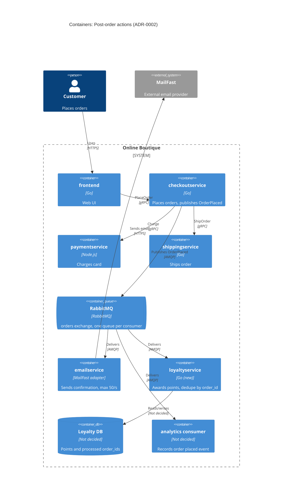

> Agent: Claude Code — model: Claude Opus 5.5 (`claude-opus-5-5`) — run b (with context)

# ADR-0002: Publish an "OrderPlaced" event to RabbitMQ for post-order actions

- **Status:** Proposed
- **Date:** 2026-10-28
- **Deciders:** ยังไม่ระบุ (ดู Open questions)

## Context and problem

R-12 (`docs/scenario.md`) กำหนดให้หลังสั่งซื้อสำเร็จ ระบบต้อง (1) ส่งอีเมลยืนยันผ่าน **MailFast** แทน logic mock ของ `emailservice` (2) ให้ loyalty points ผ่าน `loyaltyservice` ใหม่ (3) บันทึก analytics event "order placed" และ marketing คาดว่าปีหน้าจะมี post-order action เพิ่ม (SMS, fraud scoring, recommendations update)

**สภาพปัจจุบัน (จากโค้ด):**

| ข้อเท็จจริง | หลักฐาน |
|---|---|
| `PlaceOrder` เรียก `paymentservice` → `shippingservice` → `cartservice.EmptyCart` → `emailservice` ตามลำดับ แบบ synchronous gRPC | `system/online-boutique/src/checkoutservice/main.go` (`PlaceOrder`, บรรทัด 252–277) |
| ถ้าส่งอีเมลล้มเหลว จะแค่ log warning และ order ยังสำเร็จ | `main.go` บรรทัด 273–277 (`log.Warnf("failed to send order confirmation ...")`) |
| `checkoutservice` ผูกกับ downstream แต่ละตัวผ่าน env var + gRPC connection (`EMAIL_SERVICE_ADDR`, `mustConnGRPC`) | `main.go` บรรทัด 81–82, 115, 122 |
| Order ID เป็น UUID ที่สร้างใน `PlaceOrder` | `main.go` บรรทัด 233 (`uuid.NewUUID()`) |
| `checkoutservice` ไม่มี data store ของตัวเอง | Not evidenced in the provided files ว่ามี (ไม่พบ DB client ใน `main.go`) |

**ตัวเลขที่สำคัญ (`docs/scenario.md`):**

- p95 ของ `PlaceOrder` ต้อง **≤ 500 ms** (ปัจจุบัน ≈ 300 ms) ⇒ เหลือ budget ≈ 200 ms
- MailFast p95 **1.5 s**, p99 **8 s**, ล้มเหลว ≈ **0.5 %**, rate limit **50 emails/s**
- Peak **200 orders/s** (11.11) ⇒ อีเมลเกิน rate limit **4 เท่า** ⇒ backlog โต ≈ 150 emails/s (≈ 9,000 ฉบับต่อนาทีของ peak)
- Loyalty points: ภายใน **1 นาที** และ **exactly once**
- Order ต้อง **ไม่ล้มเหลว** เพราะ email / loyalty / analytics ล่ม

**ปัญหา:** ถ้าเรียก MailFast แบบ synchronous ใน `PlaceOrder` จะทำลาย latency budget ทันที (p95 1.5 s > 500 ms) และชน rate limit ช่วง peak ส่วนการเพิ่ม gRPC call ใหม่ทุกครั้งที่มี action ใหม่ ทำให้ `checkoutservice` ต้องแก้และ deploy ใหม่ทุกครั้ง เราต้องตัดสินใจว่า `checkoutservice` จะสั่งงาน post-order action อย่างไร

## Decision drivers

1. **Availability:** order ต้องไม่ล้มเหลวเพราะ email / loyalty / analytics ล่ม
2. **Performance:** p95 `PlaceOrder` ≤ 500 ms ที่ 200 orders/s
3. **Correctness ของ loyalty:** exactly once, ภายใน 1 นาที
4. **Modifiability:** เพิ่ม SMS, fraud scoring, recommendations ปีหน้าโดยไม่ต้องแก้ `checkoutservice`
5. **Rate limit ของ MailFast:** 50 emails/s ต้องรับ peak 200 orders/s ได้โดยไม่ทิ้งอีเมล
6. **Operability / team fit:** self-hosted, open-source, รันบน Kubernetes; ทีม 4 คน เก่ง Go/gRPC, 2 คนเคยใช้ RabbitMQ

## Considered options

1. **Synchronous gRPC ต่อขยาย:** `PlaceOrder` เรียก `emailservice` (MailFast), `loyaltyservice`, analytics ตามลำดับเหมือนเดิม
2. **Fire-and-forget ใน process:** `PlaceOrder` ตอบลูกค้าก่อน แล้วยิง gRPC call แต่ละตัวใน goroutine
3. **Event-driven ผ่าน RabbitMQ (self-hosted):** `checkoutservice` publish event `OrderPlaced` หนึ่งครั้งไปที่ exchange; `emailservice`, `loyaltyservice`, analytics consumer แต่ละตัวมี queue ของตัวเอง
4. **Event-driven ผ่าน Apache Kafka (self-hosted)**

### Pros and cons of the options

| Option | Pros | Cons |
|---|---|---|
| 1. Sync gRPC | ง่าย; ทีมคุ้นเคย; ไม่มี component ใหม่ | MailFast p95 1.5 s / p99 8 s ทำ p95 เกิน 500 ms; ชน rate limit 50/s ตอน peak; `checkoutservice` ต้องแก้ทุก action ใหม่ (coupling สูง) |
| 2. Goroutine fire-and-forget | latency ของลูกค้าไม่เพิ่ม; ไม่มี component ใหม่ | งานหายถ้า pod restart (ไม่มี durability); ไม่มี retry/backpressure ต่อ rate limit; loyalty exactly once ทำไม่ได้; ยังต้องแก้ `checkoutservice` ทุก action ใหม่ |
| 3. RabbitMQ | publish ครั้งเดียว (≈ ms) ใน `PlaceOrder`; queue เป็น buffer ให้ email ส่งได้ตาม 50/s; retry + dead-letter queue; เพิ่ม consumer ใหม่โดยไม่แตะ `checkoutservice`; open-source, self-hosted บน Kubernetes; มีคนในทีมเคยใช้ 2 คน | component stateful ใหม่ต้อง operate; delivery เป็น at-least-once ⇒ consumer ต้อง idempotent; ถ้า broker ล่มตอน publish ต้องมีแผนรองรับ |
| 4. Kafka | throughput สูงมาก; replay event ย้อนหลังได้ (มีประโยชน์กับ analytics) | หนักเกินไปสำหรับ 200 events/s; operate ยากกว่า; ทีมไม่มีประสบการณ์ (Not evidenced ว่ามี); rate limiting / retry ต่อข้อความต้องเขียนเอง |

## Decision

เลือก **Option 3: publish `OrderPlaced` event ไปที่ RabbitMQ (self-hosted บน Kubernetes)**

- `checkoutservice` ทำ payment + shipping แบบเดิม (synchronous) แล้ว publish `OrderPlaced` **หนึ่งครั้ง** (มี `order_id` จาก `uuid.NewUUID()`, email, items, total) แทนการเรียก `sendOrderConfirmation` (`main.go` บรรทัด 273)
- ใช้ fanout/topic exchange `orders`; แต่ละ consumer มี queue แยก ⇒ email ที่ช้าไม่ทำให้ loyalty ช้า
  - `emailservice` → MailFast, จำกัด consumer rate ≤ 50 emails/s, retry with backoff, dead-letter queue
  - `loyaltyservice` → **idempotent ด้วย `order_id`** (unique key) ⇒ at-least-once delivery + dedupe = effectively exactly once
  - analytics consumer → ส่ง event ให้ marketing
- ถ้า publish ล้มเหลว **order ยังสำเร็จ** (เหมือนพฤติกรรมปัจจุบันที่ log warning บรรทัด 273–277) และต้องมีกลไกกันงานหาย (ดู Risks)
- เหตุผล: เป็น option เดียวที่ตอบ driver 1–5 พร้อมกัน และเข้ากับ driver 6 (open-source, self-hosted, ทีมมีประสบการณ์ RabbitMQ) ส่วน Kafka ให้ความสามารถเกินความต้องการที่ 200 events/s

หมายเหตุ: technology ของ `paymentservice` (Node.js) และ `frontend` (Go) ไม่ได้อยู่ใน context files นี้ **[Inferred]**; protocol ระหว่าง `emailservice` กับ MailFast (HTTPS) ก็ **[Inferred]**

## Consequences

- **Positive:** `PlaceOrder` ไม่ต้องรอ MailFast อีกต่อไป เหลือแค่ publish หนึ่งครั้ง ⇒ p95 น่าจะอยู่ใกล้ 300 ms เดิม (quality attribute: performance) **[Inferred]** ต้องวัดจริง
- **Positive:** email / loyalty / analytics ล่มไม่กระทบ order; queue เก็บงานไว้จน consumer กลับมา (quality attribute: availability)
- **Positive:** queue ดูดซับ peak 200 orders/s แล้วปล่อยอีเมลออกที่ 50/s ตาม rate limit; retry + DLQ รับมือ failure 0.5 % ของ MailFast (quality attribute: reliability)
- **Positive:** action ใหม่ (SMS, fraud scoring, recommendations) = เพิ่ม queue + consumer ใหม่ ไม่ต้องแก้ `checkoutservice` (quality attribute: modifiability)
- **Negative:** มี component stateful ใหม่ต้อง operate, monitor, backup (quality attribute: cost / operability)
- **Negative:** อีเมลจะถึงลูกค้าช้าลงตอน peak: backlog ≈ 9,000 ฉบับต่อนาทีของ peak ต้องใช้เวลาระบายหลัง peak จบ (quality attribute: performance — email latency)
- **Negative:** at-least-once ⇒ อีเมลอาจถูกส่งซ้ำได้ถ้าไม่ dedupe; debugging ข้าม async boundary ยากขึ้น (quality attribute: usability / testability)
- **Risks and mitigations:**
  - *Broker ล่มตอน publish ⇒ event หาย ⇒ loyalty ไม่ถูกให้:* ใช้ publisher confirms + retry สั้น ๆ; ถ้ายังล้มเหลวให้ order สำเร็จและเก็บ event ไว้ส่งซ้ำ (transactional outbox) — แต่ outbox ต้องมี data store ซึ่ง `checkoutservice` ไม่มีในปัจจุบัน (Open questions)
  - *Loyalty ให้ซ้ำ:* unique constraint บน `order_id` ใน Loyalty DB, ack หลัง commit
  - *Loyalty เกิน 1 นาที:* queue แยกจาก email, alert ถ้า message age ใน loyalty queue > 30 s
  - *RabbitMQ เป็น single point of failure ของ post-order actions:* รันเป็น cluster 3 nodes + quorum queues บน Kubernetes
  - *Backlog อีเมลโตไม่หยุด:* monitor queue depth; ขอ rate limit ที่สูงขึ้นจาก MailFast ถ้า SLA อีเมลต้องการ

## Validation

- Load test ที่ **200 orders/s** (เช่นด้วย Locust `loadgenerator` แบบเดียวกับ ADR-0001): p95 `PlaceOrder` ≤ 500 ms
- Chaos test: ปิด `emailservice`, `loyaltyservice`, analytics consumer และ RabbitMQ ทีละตัว ⇒ ต้องมี order ที่ล้มเหลว = 0
- วัด end-to-end latency ของ loyalty (order → points) p99 < 1 นาที ที่ peak
- Redeliver event เดิมซ้ำโดยตั้งใจ ⇒ points ต้องถูกให้ครั้งเดียว
- ตรวจว่าอัตราส่งออกไป MailFast ไม่เกิน 50/s และ DLQ ว่างหลัง retry
- Review ADR อีกครั้งก่อนเพิ่ม consumer ตัวแรกของปีหน้า (SMS / fraud scoring)

## Open questions

- **Deciders:** ใครเป็นผู้ตัดสินใจ ADR นี้?
- **Email SLA:** อีเมลยืนยันต้องถึงลูกค้าภายในกี่นาที? (กำหนดว่า backlog ช่วง peak ยอมรับได้หรือไม่)
- **ระยะเวลา peak 11.11:** นานเท่าไร? (คำนวณ backlog และเวลาระบาย)
- **Fraud scoring:** ปีหน้าจะต้อง **block** order ก่อนยืนยันหรือไม่? ถ้าใช่ ต้องเป็น synchronous และไม่เข้ากับ event หลัง order
- **Durability ของ publish:** ยอมรับการเสีย event ได้แค่ไหนถ้า broker ล่ม? ต้องเพิ่ม data store ให้ `checkoutservice` เพื่อทำ outbox หรือไม่?
- **Analytics:** ปลายทางของ event คืออะไร (ระบบไหนของ marketing) และต้องการ schema/latency แบบใด?
- **Loyalty DB และ MailFast API:** ใช้ data store อะไร; MailFast รองรับ idempotency key หรือไม่ (กันอีเมลซ้ำ)?
- **ทีม operate RabbitMQ:** ใครรับผิดชอบ on-call สำหรับ broker (ทีมมี 4 คน)?
